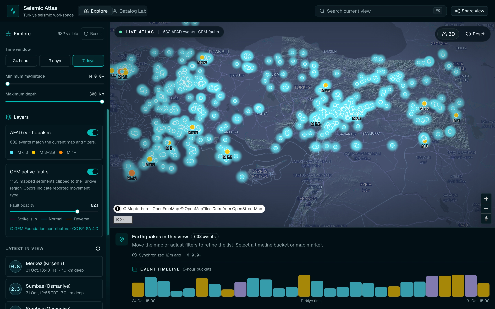
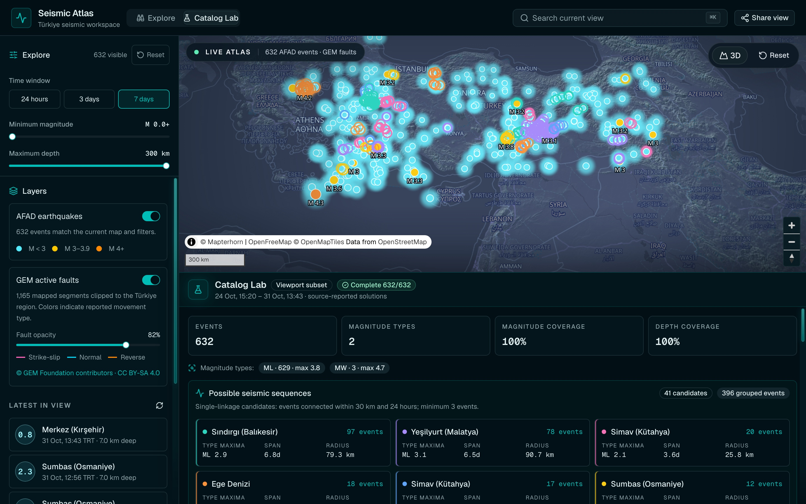
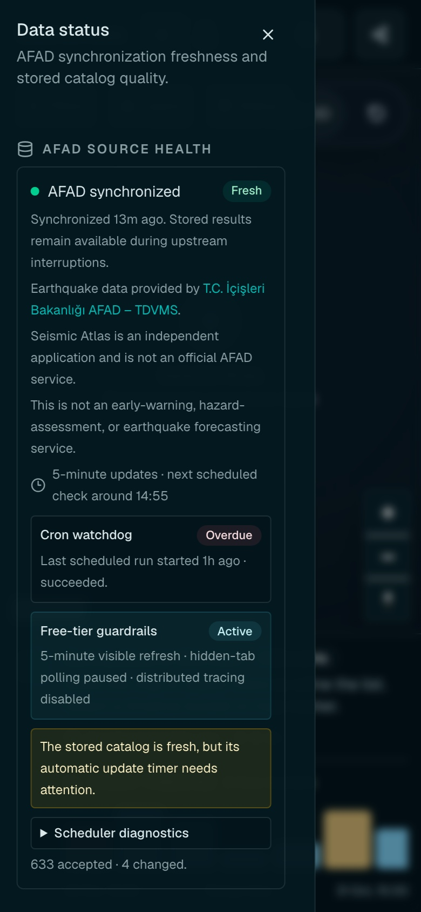
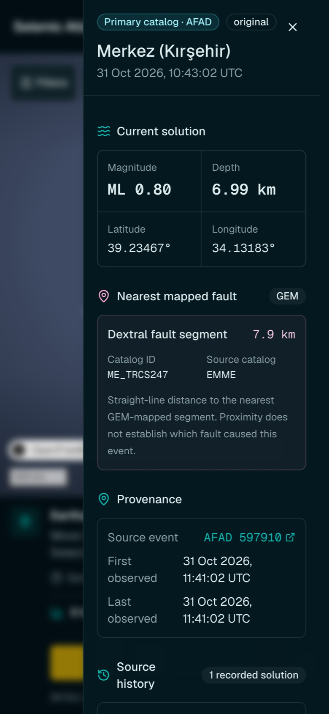
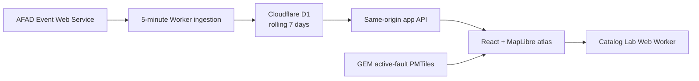

<div align="center">
  
  <h1>Seismic Atlas</h1>
  <p><strong>A map-first, provenance-aware workspace for exploring recent seismicity in Türkiye.</strong></p>
  <p>Live AFAD observations, regional active faults, transparent data health, and browser-side catalog analysis in one focused interface.</p>
  <p>
    <a href="https://github.com/frknuynk/seismic-atlas/actions/workflows/ci.yml"></a>
    
    
    
    
  </p>
</div>



> [!IMPORTANT]
> Seismic Atlas is an independent exploration and research interface. It is not
> an official AFAD service, an early-warning system, a hazard assessment, or an
> earthquake forecasting product.

## What it does

| Explore                                            | Investigate                                                                 | Analyze                                                                                  | Trust                                                                               |
| -------------------------------------------------- | --------------------------------------------------------------------------- | ---------------------------------------------------------------------------------------- | ----------------------------------------------------------------------------------- |
| View recent AFAD events on a terrain-aware 3D map. | Inspect source values, revisions, and the nearest GEM-mapped fault segment. | Study distributions and reproducible proximity-based sequence candidates in Catalog Lab. | See source freshness, scheduler health, completeness, and protective circuit state. |

- Synchronizes the official AFAD Event Web Service every five minutes.
- Keeps a rolling seven-day catalog instead of building a historical mirror.
- Combines earthquake markers, 1,165 regional GEM active-fault segments, search,
  filters, and a synchronized event timeline.
- Preserves source provenance and revisions without reclassifying earthquakes.
- Runs catalog and sequence analysis in a browser Web Worker.
- Remains useful during short upstream interruptions by serving the last stored
  catalog with an explicit freshness warning.

## Product tour

### Explore recent seismicity

Filter the last 24 hours, three days, or seven days; search within the current
map view; select timeline buckets; and open any event without leaving the map.

### Catalog Lab

Catalog Lab analyzes the exact verified map subset. It reports magnitude and
depth coverage, distribution charts, completeness status, and proximity-based
sequence candidates. It does **not** infer mainshocks, aftershocks, causation,
hazard, or future seismicity.



### Mobile data trust and provenance

|                                                                   Data status                                                                   |                                                                   Event detail                                                                   |
| :---------------------------------------------------------------------------------------------------------------------------------------------: | :----------------------------------------------------------------------------------------------------------------------------------------------: |
|  |  |
|                                        Freshness, cron watchdog, attribution, and free-tier guardrails.                                         |                                  Source solution, nearest mapped fault, AFAD event link, and revision history.                                   |

## How it works



The ingestion path is bounded and revision-aware. It uses source-specific
cursors, overlapping windows, deterministic deduplication, D1 leases, retries,
quarantine records, a persistent circuit breaker, and daily seven-day
reconciliation. A retention sweep removes older AFAD payloads and all inactive
source catalog data.

## Safety and data guardrails

- **AFAD-only production catalog.** USGS and EMSC adapters are dormant and are
  not invoked by production cron, production routes, or the UI.
- **No bulk redistribution surface.** There is no CSV export, GeoJSON export,
  historical archive, or documented general-purpose earthquake API.
- **First-party reads only.** Catalog routes require same-origin browser fetch
  metadata, accept only `AFAD`, and reject ranges longer than 168 hours.
- **Transparent freshness.** Fresh, delayed, and stale states are separate from
  upstream errors and scheduler health.
- **Failure-safe ingestion.** Saturated or invalid source responses fail closed
  without advancing the ingestion cursor.
- **Free-tier conscious.** Visible-tab event polling runs every five minutes;
  background polling stops; Catalog Lab quality checks are cached for 15
  minutes; distributed tracing is disabled.

## Quick start

The following path has been verified against the current repository and a real
AFAD synchronization.

### Prerequisites

- Node.js **22.13 or newer**
- npm **10 or newer**
- Network access to `https://deprem.afad.gov.tr`
- Tippecanoe **2.79 or newer** only if you intend to rebuild the fault tiles

### 1. Clone and install

```bash
git clone https://github.com/frknuynk/seismic-atlas.git
cd seismic-atlas
npm ci
```

### 2. Create the local D1 database

```bash
npm run db:migrate:local
```

Wrangler stores the local database under `.wrangler/`; it is intentionally not
tracked by Git.

### 3. Load the current seven-day AFAD window

Keep the development server stopped while this command writes to local D1:

```bash
npm run sync:afad:local -- --minutes=10080
```

A successful result includes:

```text
"source": "AFAD"
"status": "succeeded"
"windowKind": "manual"
"retention": { ... }
```

### 4. Start the application

```bash
npm run dev
```

Open the URL printed by Vinext (normally [http://localhost:5173](http://localhost:5173)). The first map load should
show recent markers, an event count, and a synchronized timestamp. The service
health endpoint is available at
[`/api/v1/health`](http://localhost:5173/api/v1/health); catalog endpoints are
intentionally reserved for the first-party browser application.

### 5. Simulate the scheduled path

Stop the development server, then run:

```bash
npm run sync:afad:scheduled:local
```

This exercises the scheduled ingestion path and records a local cron run for
the scheduler watchdog. It does not prove that a deployed Cloudflare Cron
Trigger is firing.

## Validation

Run the same quality gate used by CI:

```bash
npm run check
```

`npm run check` executes, in order:

1. TypeScript type checking
2. Oxlint
3. Node, real workerd/D1, and Chromium Browser Mode Vitest projects
4. A production Vinext build and bundle-budget check
5. Deterministic Chromium Playwright E2E with Axe

Latest verified local baseline:

```text
33 test files passed
138 tests passed
4 Playwright scenarios passed
85.28% line / 69.20% branch coverage
0 production dependency advisories
Typecheck clean
Lint clean
Production build successful
```

Individual commands:

| Goal                    | Command                                      |
| ----------------------- | -------------------------------------------- |
| Development server      | `npm run dev`                                |
| Type checking           | `npm run typecheck`                          |
| Lint                    | `npm run lint`                               |
| Unit/integration tests  | `npm test`                                   |
| Node tests only         | `npm run test:node`                          |
| Real workerd + D1 tests | `npm run test:worker`                        |
| Browser component tests | `npm run test:browser`                       |
| Playwright E2E          | `npm run test:e2e`                           |
| Full source coverage    | `npm run test:coverage`                      |
| Watch tests             | `npm run test:watch`                         |
| Production build        | `npm run build`                              |
| Full quality gate       | `npm run check`                              |
| AFAD seven-day sync     | `npm run sync:afad:local -- --minutes=10080` |
| Local scheduled sync    | `npm run sync:afad:scheduled:local`          |
| Rebuild fault tiles     | `npm run data:build:faults`                  |

### Persona QA

Four project-specific agent skills turn release review into repeatable evidence:

| Perspective                                 | Skill                                |
| ------------------------------------------- | ------------------------------------ |
| Product value and release acceptance        | `skills/seismic-atlas-owner-qa`      |
| Non-specialist usability and accessibility  | `skills/seismic-atlas-enthusiast-qa` |
| Scientific meaning and provenance           | `skills/seismic-atlas-geologist-qa`  |
| Runtime, security, resilience, and coverage | `skills/seismic-atlas-engineer-qa`   |

Their research basis and latest combined results are documented in
[`docs/quality/persona-research.md`](docs/quality/persona-research.md) and
[`docs/quality/coverage-report.md`](docs/quality/coverage-report.md).

## Configuration

The default basemap works without an API key. Create `.env.local` only when you
need to override local settings:

```bash
cp .env.example .env.local
```

| Variable                        | Required locally | Purpose                                            |
| ------------------------------- | :--------------: | -------------------------------------------------- |
| `NEXT_PUBLIC_BASEMAP_STYLE_URL` |        No        | Overrides the MapLibre style URL.                  |
| `AFAD_SYNC_TOKEN`               |        No        | Protects manual synchronization outside localhost. |

Production additionally requires a real D1 database identifier, the `DB`
binding, the `MANUAL_SYNC_RATE_LIMIT` binding, `AFAD_SYNC_TOKEN`, and the
five-minute Cron Trigger declared in `wrangler.jsonc`. Production identifiers
and secrets are intentionally not committed.

## Architecture

| Layer     | Technology                     | Responsibility                                         |
| --------- | ------------------------------ | ------------------------------------------------------ |
| Interface | React 19, Vinext, Tailwind CSS | Map-first desktop and mobile workspace                 |
| Mapping   | MapLibre GL JS, PMTiles        | Terrain, earthquake markers, and fault vectors         |
| Analysis  | Web Worker, Recharts           | Catalog metrics and sequence exploration               |
| Runtime   | Cloudflare Workers, Hono       | App delivery, protected routes, scheduled ingestion    |
| Storage   | Cloudflare D1, Drizzle schema  | Events, revisions, health, leases, and run diagnostics |
| Contracts | Zod, TypeScript                | Shared runtime validation and types                    |
| Quality   | Vitest, Oxlint, GitHub Actions | Automated regression and production-build checks       |

Key directories:

```text
app/                 Pages and application API routes
components/          Atlas, map, and UI components
hooks/               Browser data and analysis state
worker/              Ingestion, catalog queries, retention, and observability
db/                  D1 schema and environment types
migrations/          Ordered D1 migrations
public/data/faults/   Browser-ready GEM fault derivative
tests/                Unit and SQLite-backed integration coverage
```

## Troubleshooting

### `Local D1 state was not found`

Run the migrations before synchronization:

```bash
npm run db:migrate:local
```

### `AFAD_NETWORK_ERROR`

Confirm that `https://deprem.afad.gov.tr` is reachable and retry the sync. The
adapter already performs bounded retries; persistent DNS, TLS, or upstream
errors are reported without advancing the source cursor.

### The UI says the scheduler is missing

For local development, stop `npm run dev` and run:

```bash
npm run sync:afad:scheduled:local
```

### The map has fewer events than the total catalog

The visible result respects the current time, magnitude, depth, map bounds, and
timeline selection. Use **Reset** and choose **7 days** to return to the full
recent view.

## Data sources and attribution

### Earthquakes

- Source: [T.C. İçişleri Bakanlığı AFAD – TDVMS](https://deprem.afad.gov.tr/event-service)
- Product policy: rolling seven-day window, source attribution, no bulk export
- Parameters are source-reported estimates and may be revised

### Active faults

The checked-in browser assets under `public/data/faults/` are a Türkiye-region
derivative of the
[GEM Global Active Faults Database](https://github.com/GEMScienceTools/gem-global-active-faults),
licensed under CC BY-SA 4.0.

- Source revision: `56816508ad92fd6846dad1163b1c8c01376a2cd1`
- Source SHA-256: `603513086b4693de6008e3444959995c34683b30dac291856340522a76d8505e`
- Attribution: © GEM Foundation contributors
- Processing: clipped to `22°E–47°E, 33°N–44°N`, reduced to five-decimal
  coordinate precision, unused attributes removed, tiled as PMTiles

A nearby mapped segment does not establish which fault caused an earthquake.
The layer is regional context and is not suitable for site-specific engineering
or hazard decisions.

### Map and terrain

The interface preserves the required in-map attribution for OpenFreeMap,
OpenMapTiles, OpenStreetMap, Mapterhorn, and GEM data.

## Production readiness

Before a public deployment:

- Configure the production D1 binding and apply every migration.
- Store `AFAD_SYNC_TOKEN` as a secret; never commit it.
- Verify one authenticated remote sync before enabling cron.
- Confirm `/api/v1/source-health` reports a recent successful scheduled run.
- Check AFAD attribution, the independent-product disclaimer, and map-provider
  attribution in the deployed UI.
- Run `npm run check` from a clean checkout.

Current status: **v0.8 alpha · local production candidate · not yet publicly
deployed**.
