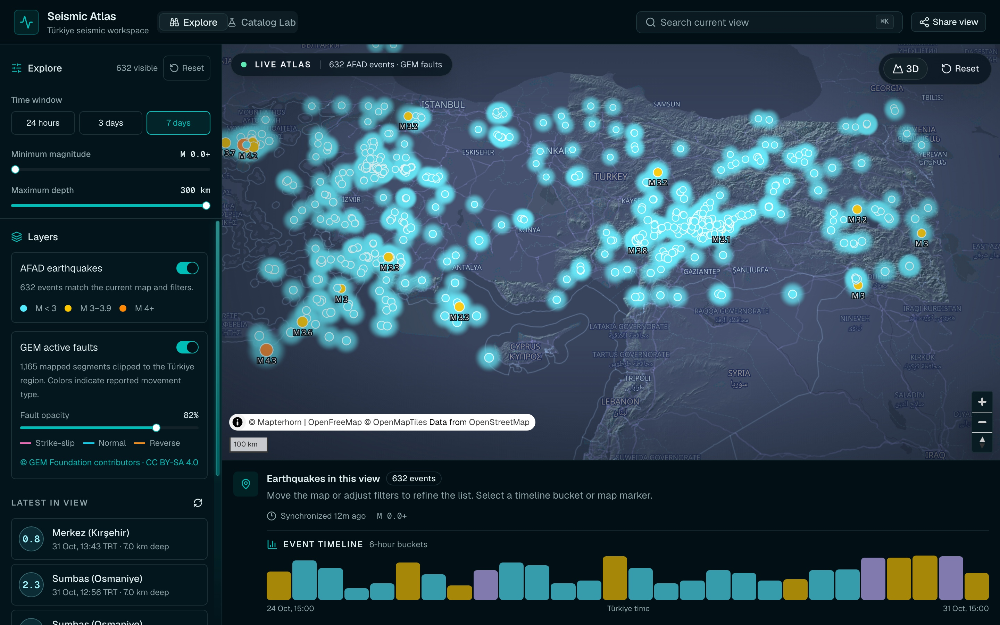
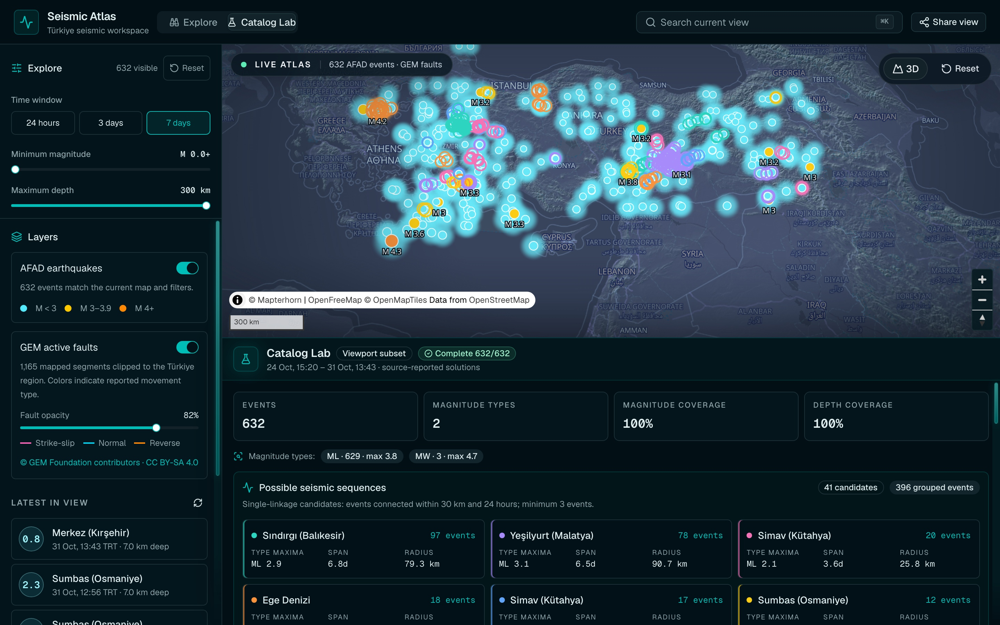
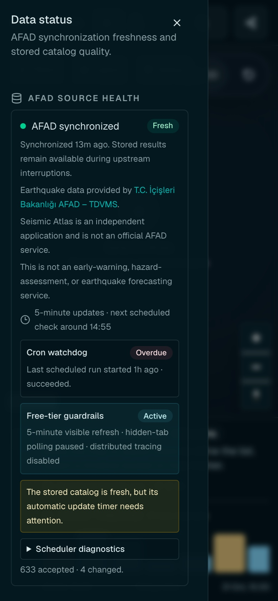
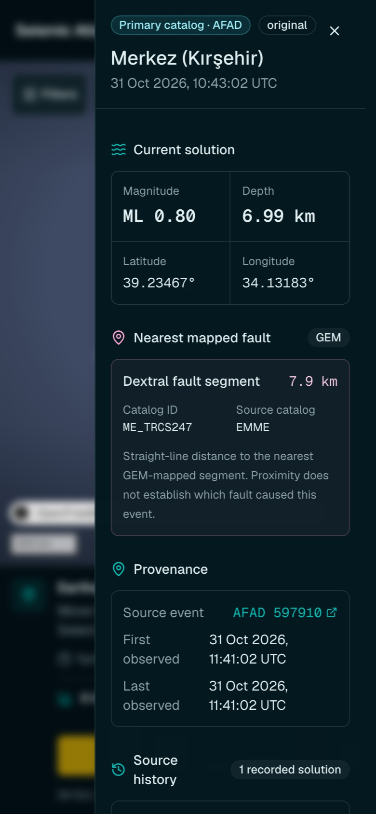

# Seismic Atlas Production Hardening Report

Report date: 2026-10-31
Target: local `v0.8.0-alpha.0`, AFAD-backed D1, production Worker build

## Executive result

**Local release decision: GO.** Deployment and production D1 mutation remain
explicitly out of scope. All 35 persona checks pass with no `FAIL` or `BLOCKED`
result and no open High/Medium finding.

## Automated gates

| Gate                                | Result                                                   |
| ----------------------------------- | -------------------------------------------------------- |
| Typecheck / Oxlint                  | Pass                                                     |
| Vitest multi-project                | 33 files / 138 tests passed                              |
| Real workerd + isolated D1          | Pass                                                     |
| Vitest Browser Mode (Chromium)      | Pass                                                     |
| Playwright desktop + 390×844 mobile | 4/4 passed                                               |
| Axe serious/critical                | 0 violations                                             |
| Production build                    | Pass                                                     |
| Bundle budget                       | Pass: app chunks ≤500 kB; MapLibre vendor/worker ≤1.2 MB |
| `npm audit --omit=dev`              | 0 total vulnerabilities                                  |

The Worker suite applies the real migration set to isolated D1 storage and
exercises retention, same-origin route policy, private cache/no-CORS behavior,
security headers, route modules, Worker fetch error envelopes, and scheduler
entry. Browser fixtures are deterministic and use an empty local map style.

## Coverage

Command: `npm run test:coverage`

| Metric     | Covered / total |   Coverage | Gate |
| ---------- | --------------: | ---------: | ---: |
| Lines      |   1,432 / 1,679 | **85.28%** |  70% |
| Statements |   1,527 / 1,834 | **83.26%** |  70% |
| Functions  |       341 / 416 | **81.97%** |  65% |
| Branches   |   1,007 / 1,455 | **69.20%** |  60% |

Critical aggregates now have executable coverage: API routes run inside
workerd with D1, Worker logic is above 98% line coverage, Atlas UI is above 71%
line coverage, and hooks are above 79% line coverage. Declarative schema files
are excluded; migration behavior and `db/index.ts` are exercised through the
runtime project.

## Retention and runtime result

- Manual and scheduled ingestion share `sync → succeeded-only retention`.
- `skipped`, `failed`, and thrown syncs preserve the physical catalog.
- Retention failure rejects the scheduled operation and is recorded as a cron
  failure.
- A real local seven-day AFAD synchronization succeeded with 633 accepted,
  0 rejected, and 0 duplicates; retention removed three expired events and
  their revisions.
- The catalog route remains same-origin, AFAD-only, 168-hour bounded,
  private-cache, and CORS-closed.

## Persona rerun

| Persona                   |    Checks | Result   | Evidence                                                                      |
| ------------------------- | --------: | -------- | ----------------------------------------------------------------------------- |
| Product owner (`O1`–`O8`) |       8/8 | PASS     | Explore, detail, Lab, mobile Status, failure language, product boundary       |
| Enthusiast (`E1`–`E8`)    |       8/8 | PASS     | Search/filter/detail, TRT/UTC labels, reset, keyboard names, 44 px targets    |
| Geologist (`G1`–`G9`)     |       9/9 | PASS     | provenance, initial/revision wording, ML/MW separation, neutral mixed buckets |
| Engineer (`F1`–`F10`)     |     10/10 | PASS     | workerd/D1, route policy, retention order, audit, coverage, bundle/E2E gates  |
| **Total**                 | **35/35** | **PASS** | **0 FAIL · 0 BLOCKED**                                                        |

## Browser evidence

The screenshots below were recaptured from the final local production build
after the automated acceptance run.

|                                                                Mobile source health                                                                |                                                                    Mobile event provenance                                                                    |
| :------------------------------------------------------------------------------------------------------------------------------------------------: | :-----------------------------------------------------------------------------------------------------------------------------------------------------------: |
|  |  |

## Security and dependency result

The requested exact runtime/toolchain versions are installed. Patched
transitive overrides pin `fast-uri` 3.1.9 and `fflate` 0.8.3 without `--force`.
Production audit reports zero low, moderate, high, or critical advisories.

MapLibre uses its ESM namespace API, a same-origin Vite worker URL, the v6
missing-image resolver, and an explicit WebGL2 fallback. Production CSP is
`worker-src 'self'`. Vinext still requires `script-src 'unsafe-inline'`; that
residual framework constraint is retained and bounded by same-origin routes,
strict response headers, and zero production dependency advisories. Localhost
development alone adds `unsafe-eval` so React development hydration works;
production responses do not.

## Scientific and product result

- Catalog analysis v3 groups maximum, histogram, and frequency–magnitude data
  by magnitude type. Histograms require 10 observations; frequency curves
  require 50.
- Sequence method v2 carries type-specific maxima and a centroid-nearest
  representative event; ordering is deterministic.
- Timeline mixed-type buckets use neutral color and announce each type maximum.
- Source health permanently states that the app is not early warning, hazard
  assessment, or forecasting.
- Missing place and source history now use scientifically honest labels.
- Explore and Lab use a layout-managed dock; map controls and attribution no
  longer share an absolute overlay with the analysis panel.

## Residual limitations (Low)

- The production build still emits upstream Vinext/RSC sourcemap and dynamic
  import warnings; bundle budgets pass and no runtime defect was observed.
- Cross-browser Firefox/WebKit smoke is configured for main and scheduled CI;
  the local acceptance run used Chromium.
- No physical mobile device, screen reader, deployed Cron trigger, production
  D1, or field Core Web Vitals dataset was used.
